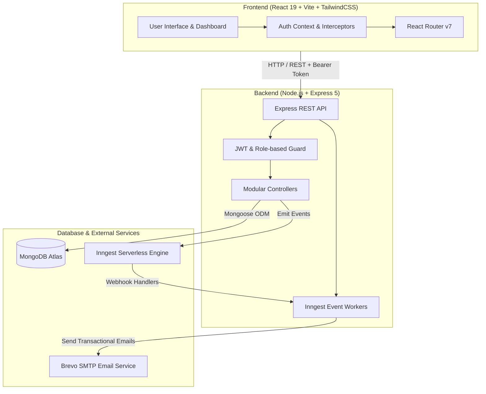

<div align="center">

# ⚡ QuickEMS — Full-Stack Employee Management System

<p align="center">
  <strong>A modern, enterprise-ready Employee Management System built with React, Node.js, Express, MongoDB, Tailwind CSS, and Inngest workflow automation.</strong>
</p>

[](https://react.dev/)
[](https://nodejs.org/)
[](https://expressjs.com/)
[](https://www.mongodb.com/)
[](https://tailwindcss.com/)
[](https://www.inngest.com/)
[](https://vitejs.dev/)
[](https://opensource.org/licenses/MIT)

<br/>

[Key Features](#-key-features) •
[Architecture](#-system-architecture) •
[Tech Stack](#-tech-stack) •
[Getting Started](#-getting-started) •
[Environment Variables](#-environment-variables) •
[API Endpoints](#-api-endpoints) •
[Deployment](#-deployment)

</div>

---

## 📖 Overview

**QuickEMS** is an all-in-one workforce management solution designed to streamline HR operations, employee record management, daily attendance logging, time-off requests, and automated monthly payroll generation.

Featuring role-based authentication (**Admin** and **Employee**), responsive sleek modern glassmorphism UI, real-time analytics, and serverless background event automation powered by **Inngest** and **Brevo SMTP**.

---

## ✨ Key Features

### 🛡️ Admin Portal
- **Executive Dashboard**: Real-time overview of workforce size, departments, daily check-in attendance counters, and pending leave reviews.
- **Employee Lifecycle Management**:
  - Add new team members with position, department, custom compensation packages (basic salary, allowances, deductions), and bio.
  - Full edit capabilities, account role configuration, and password resets.
  - Soft deletion with account deactivation safeguard and reactivate toggle.
- **Department Filtering & Search**: Instant real-time multi-field search and department categorization.
- **Leave Application Approvals**: Review time-off submissions with employee details, reason, date ranges, and one-click Approval/Rejection actions.
- **Automated Payslip Engine**: Generate itemized monthly payslips with auto-populated salary configurations and calculated net totals.

### 💼 Employee Portal
- **Interactive Check-In / Check-Out**:
  - Dynamic clock-in/out tracking with automatic late detection (after 9:00 AM).
  - Live shift duration tracking and automated day-type classification (*Full Day*, *Three Quarter Day*, *Half Day*, *Short Day*).
  - Attendance history log with interactive stats and real-time average hours computation.
- **Leave Management**:
  - Submit leave requests (*Sick*, *Casual*, *Annual*) with calendar constraints and validation.
  - Track real-time status badges (*Pending*, *Approved*, *Rejected*) and historical time taken.
- **Payslips & Salary Slips**:
  - View historical payslips with breakdown of basic salary, allowances, deductions, and net earnings.
  - Built-in printable payslip view formatted for physical printing or saving as PDF.
- **Profile & Account Security**: Self-service profile updates and secure password changes.

### ⚡ Background Workflows & Cron Jobs (Inngest Automation)
1. **Auto Check-Out & Reminder**:
   - Triggers upon check-in; waits 9 hours to check if employee logged out.
   - Sends a friendly email reminder if employee hasn't checked out.
   - If unchecked after 10 hours, marks status as `LATE` and day type as `Half Day`.
2. **Leave Escalation Reminder**:
   - Triggers when a leave application is filed.
   - If unreviewed after 24 hours, automatically notifies admin via email.
3. **Daily Attendance Absentee Cron Job**:
   - Scheduled every day at 11:30 AM IST (`TZ=Asia/Kolkata 30 11 * * *`).
   - Identifies active non-deleted employees not on approved leave who missed check-in.
   - Dispatches automated email notifications via Brevo SMTP.

---

## 🏗 System Architecture



---

## 🛠 Tech Stack

### Frontend
- **Framework**: [React 19](https://react.dev/)
- **Bundler**: [Vite 8](https://vitejs.dev/)
- **Styling**: [Tailwind CSS v4](https://tailwindcss.com/)
- **Icons**: [Lucide React](https://lucide.dev/)
- **Routing**: [React Router 7](https://reactrouter.com/)
- **HTTP Client**: [Axios](https://axios-http.com/)
- **Notifications**: [React Hot Toast](https://react-hot-toast.com/)
- **Date Utilities**: [date-fns](https://date-fns.org/)

### Backend
- **Runtime**: [Node.js](https://nodejs.org/) (ES Modules)
- **Framework**: [Express 5](https://expressjs.com/)
- **Database**: [MongoDB](https://www.mongodb.com/) with [Mongoose 9](https://mongoosejs.com/)
- **Authentication**: [JSON Web Tokens (JWT)](https://jwt.io/) & [bcrypt](https://www.npmjs.com/package/bcrypt)
- **Background Jobs & Crons**: [Inngest](https://www.inngest.com/)
- **Email Service**: [Nodemailer](https://nodemailer.com/) + Brevo SMTP
- **Form Parser**: [Multer](https://github.com/expressjs/multer)

---

## 📁 Repository Structure

```text
FullStack-EMS/
├── client/                     # Frontend React application
│   ├── public/                 # Static assets & favicons
│   ├── src/
│   │   ├── api/                # Axios configuration & interceptors
│   │   ├── assets/             # Global data assets & helpers
│   │   ├── components/         # Reusable UI components
│   │   │   ├── attendance/     # Clock-in button, stats, activity table
│   │   │   ├── leave/          # Leave modals & approval cards
│   │   │   └── payslip/        # Payslip generation form & list
│   │   ├── context/            # AuthContext & useAuth hook
│   │   ├── pages/              # Routed pages (Dashboard, Employees, Attendance, etc.)
│   │   ├── App.jsx             # Route definitions & guards
│   │   ├── index.css           # Tailwind CSS directives & custom design tokens
│   │   └── main.jsx            # React root mount
│   ├── package.json
│   ├── vercel.json             # Frontend SPA rewrite rules
│   └── vite.config.js
│
├── server/                     # Backend Node.js / Express application
│   ├── config/                 # MongoDB & Nodemailer configs
│   ├── constants/              # System departments & constants
│   ├── controllers/            # Controller logic for all entities
│   ├── inngest/                # Inngest event triggers & cron definitions
│   ├── middleware/             # JWT auth & admin guard middleware
│   ├── models/                 # Mongoose schemas (User, Employee, Attendance, etc.)
│   ├── routes/                 # Express API routes
│   ├── seed.js                 # Initial admin account seeder
│   ├── server.js               # Express application entrypoint
│   ├── vercel.json             # Serverless configuration for backend
│   └── package.json
│
├── .gitignore                  # Git ignore rules (node_modules, .env, builds)
├── package.json                # Root package for monorepo convenience scripts
└── README.md                   # Project documentation
```

---

## 🚀 Getting Started

### 1. Prerequisites
- **Node.js** (v18.0.0 or higher recommended)
- **npm** (v9.0.0 or higher)
- **MongoDB Atlas** cluster URI
- *(Optional)* **Brevo** account for SMTP email delivery
- *(Optional)* **Inngest** account for background workflows

---

### 2. Clone the Repository

```bash
git clone https://github.com/itz-rishi/FullStack-EMS.git
cd FullStack-EMS
```

---

### 3. Install Dependencies

You can install all dependencies across the project with a single command from root:

```bash
npm run install:all
```

*Or install individually:*
```bash
# Server dependencies
cd server && npm install

# Client dependencies
cd ../client && npm install
```

---

### 4. Configure Environment Variables

Create `.env` files in both the `server` and `client` directories using the provided templates:

#### **Server (`server/.env`)**
```env
PORT=4000
JWT_SECRET="your_secure_jwt_secret_key"
ADMIN_EMAIL="admin@example.com"
MONGODB_URI="mongodb+srv://<username>:<password>@cluster0.example.mongodb.net/fullstack-ems?retryWrites=true&w=majority"

# Inngest Configuration
INNGEST_EVENT_KEY="your_inngest_event_key"
INNGEST_SIGNING_KEY="your_inngest_signing_key"

# SMTP (Brevo / Sendinblue)
SMTP_USER="your_smtp_user"
SMTP_PASS="your_smtp_password"
SENDER_EMAIL="your_verified_sender_email@example.com"
```

#### **Client (`client/.env`)**
```env
VITE_BASE_URL="http://localhost:4000"
```

---

### 5. Seed the Initial Admin Account

Run the database seeder to initialize your administrative credentials:

```bash
# From root
npm run seed

# Or inside the server folder
cd server
npm run seed
```

This creates an administrator user in your MongoDB database with the email configured in `ADMIN_EMAIL` and the initial password:
- **Email**: `ADMIN_EMAIL` (from `.env`)
- **Default Password**: `admin123` *(Be sure to change this upon initial login via Settings)*

---

### 6. Run the Application Locally

#### Start the Server:
```bash
# From root
npm run server

# Or inside server directory
cd server && npm run server
```
*Backend runs on `http://localhost:4000`.*

#### Start the Client:
```bash
# From root
npm run dev

# Or inside client directory
cd client && npm run dev
```
*Frontend runs on `http://localhost:5173`.*

---

## ⚙️ Environment Variables

### Backend (`server/.env`)

| Variable | Description | Default / Example |
|---|---|---|
| `PORT` | Port for the Express server to listen on | `4000` |
| `MONGODB_URI` | MongoDB Atlas or local MongoDB connection URI | `mongodb+srv://...` |
| `JWT_SECRET` | Secret string for signing JWT tokens | `super-secret-jwt-key` |
| `ADMIN_EMAIL` | Default administrator email for initial seeding | `admin@example.com` |
| `INNGEST_EVENT_KEY` | Inngest event publication key | `your_event_key` |
| `INNGEST_SIGNING_KEY` | Inngest webhook signature verification key | `your_signing_key` |
| `SMTP_USER` | Brevo SMTP username | `apikey` |
| `SMTP_PASS` | Brevo SMTP password / key | `your_smtp_key` |
| `SENDER_EMAIL` | Verified sender address for outbound emails | `no-reply@yourdomain.com` |

### Frontend (`client/.env`)

| Variable | Description | Default / Example |
|---|---|---|
| `VITE_BASE_URL` | Root URL for the backend API | `http://localhost:4000` |

---

## 📡 API Endpoints

### 🔐 Authentication (`/api/auth`)
| Method | Endpoint | Access | Description |
|---|---|---|---|
| `POST` | `/api/auth/login` | Public | Authenticate user & issue JWT token |
| `GET` | `/api/auth/session` | Authenticated | Retrieve current session user information |
| `POST` | `/api/auth/change-password` | Authenticated | Change current user's password |

### 👥 Employees (`/api/employees`)
| Method | Endpoint | Access | Description |
|---|---|---|---|
| `GET` | `/api/employees` | Admin | Fetch employee directory with optional `?department=` filter |
| `POST` | `/api/employees` | Admin | Create new employee profile & user account |
| `PUT` | `/api/employees/:id` | Admin | Update employee compensation, role, profile details |
| `DELETE` | `/api/employees/:id` | Admin | Soft delete and deactivate employee account |

### 🕒 Attendance (`/api/attendance`)
| Method | Endpoint | Access | Description |
|---|---|---|---|
| `POST` | `/api/attendance` | Employee | Clock in or clock out for today |
| `GET` | `/api/attendance` | Authenticated | Get attendance activity history & statistics |

### 📅 Leaves (`/api/leave`)
| Method | Endpoint | Access | Description |
|---|---|---|---|
| `GET` | `/api/leave` | Authenticated | List leave applications (Admin views all; Employee views self) |
| `POST` | `/api/leave` | Employee | Submit new leave application |
| `PATCH` | `/api/leave/:id` | Admin | Approve or reject a pending leave application |

### 💵 Payslips (`/api/payslips`)
| Method | Endpoint | Access | Description |
|---|---|---|---|
| `GET` | `/api/payslips` | Authenticated | List generated payslips |
| `GET` | `/api/payslips/:id` | Authenticated | Get detailed payslip breakdown for print/download |
| `POST` | `/api/payslips` | Admin | Generate a new monthly payslip for an employee |

### 📊 Dashboard (`/api/dashboard`)
| Method | Endpoint | Access | Description |
|---|---|---|---|
| `GET` | `/api/dashboard` | Authenticated | Get role-tailored dashboard metrics and stats |

### ⚙️ Inngest Integration (`/api/inngest`)
| Method | Endpoint | Access | Description |
|---|---|---|---|
| `GET` / `POST` / `PUT` | `/api/inngest` | Inngest Webhook | Inngest event execution and cron listener |

---

## 🌐 Deployment

### Deploy Backend to Vercel
1. Set up a new project on [Vercel](https://vercel.com/) pointing to the `server/` directory.
2. In the Vercel dashboard, add all Environment Variables (`MONGODB_URI`, `JWT_SECRET`, `ADMIN_EMAIL`, etc.).
3. The included `server/vercel.json` automatically configures the Node.js serverless functions.
4. Copy your Vercel deployment URL (e.g. `https://your-server.vercel.app`) and configure it inside the Inngest dashboard with endpoint `/api/inngest`.

### Deploy Frontend to Vercel
1. Set up a separate project on [Vercel](https://vercel.com/) pointing to the `client/` directory.
2. Set Environment Variable: `VITE_BASE_URL=https://your-server.vercel.app`
3. The included `client/vercel.json` provides SPA routing rewrites for React Router.

---

## 🤝 Contributing

Contributions, issues, and feature requests are welcome!

1. Fork the repository
2. Create your feature branch (`git checkout -b feature/AmazingFeature`)
3. Commit your changes (`git commit -m 'Add some AmazingFeature'`)
4. Push to the branch (`git push origin feature/AmazingFeature`)
5. Open a Pull Request

---

## 📄 License

This project is licensed under the [MIT License](LICENSE).

---

<div align="center">
  <sub>Built with ❤️ by <a href="https://github.com/itz-rishi">Rishi</a></sub>
</div>
